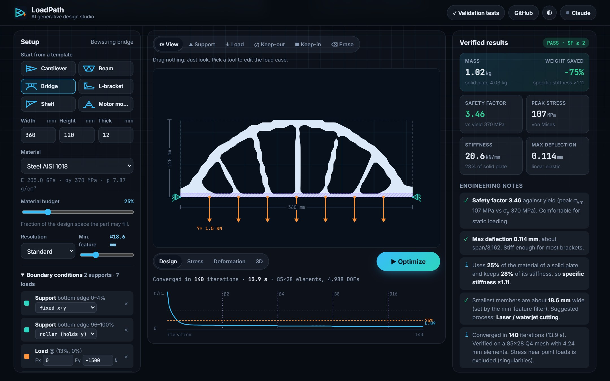
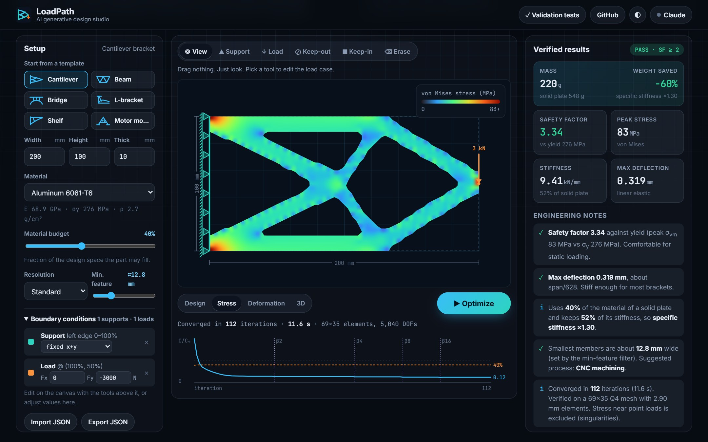
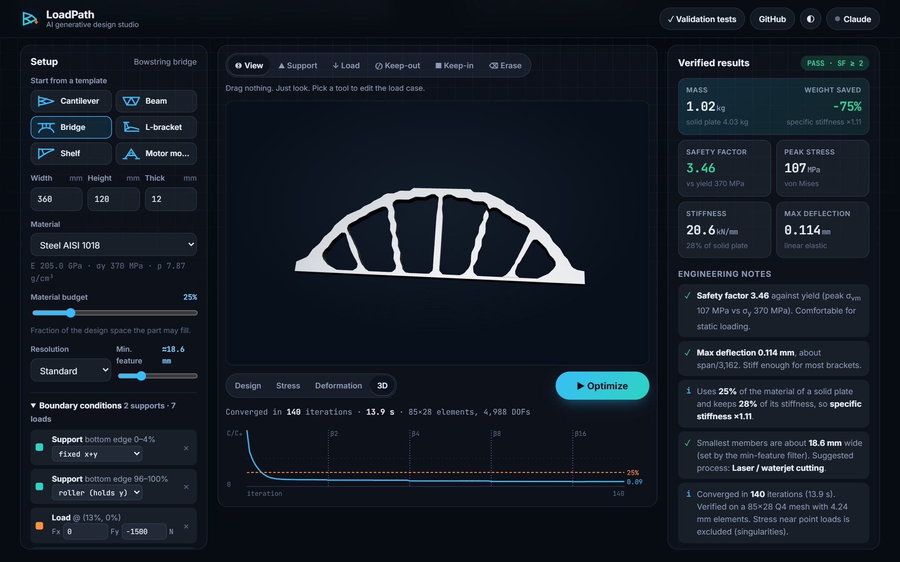
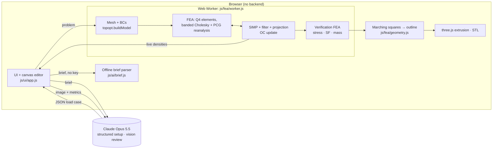

<div align="center">


# LoadPath: AI Generative Design Studio

**Describe a part in plain English and watch physics design it.**
LoadPath turns a design brief into a structural load case with Claude. A from-scratch finite-element solver then runs topology optimization in your browser to grow the lightest part that carries the load. It checks the result for stress and safety factor, and exports a 3D-printable STL.

`JavaScript` · `Finite Element Analysis` · `Topology Optimization (SIMP)` · `Claude API` · `Web Workers` · `three.js` · `GitHub Pages`

**[▶ Live demo](https://kenny-robinson1978.github.io/loadpath/)**: pick a template and press **Optimize**



</div>

---

## Why I built this

Generative design is reshaping how mechanical engineers work. Aerospace brackets, F1 uprights and 3D-printed medical implants are increasingly shaped by optimization rather than drawn by hand. The commercial tools are expensive black boxes, so I wanted to build the whole pipeline myself and understand every step:

1. **Physics I can verify.** I wrote my own FEA solver and validated it against beam theory, instead of trusting a library.
2. **Optimization I can explain.** Every line of the SIMP algorithm, the filters and the sensitivity analysis is in this repo, and the test suite checks the gradients.
3. **AI where it actually helps.** Setting up boundary conditions is the tedious, error-prone part for non-experts. Reviewing a design for manufacturability takes experience. Claude does both, and the physics stays deterministic.

## Features

| | Feature | How it works |
|---|---|---|
| ✦ | **Design brief → load case** | Claude (Opus 5.5) reads a plain-English brief such as *"3D-printed shelf bracket holding 15 kg, bolted top and bottom"*. It returns a **JSON-schema-validated** problem: domain, supports, forces, keep-out/keep-in regions, plus a list of every assumption it made. Without an API key, a transparent rule-based parser does it offline. |
| 🧮 | **Finite-element solver** | Bilinear Q4 plane-stress elements, a **banded Cholesky** factorization (nodes numbered along the short side to minimize bandwidth), and a **reanalysis solver** that reuses the last factor as a CG preconditioner between design iterations. |
| 🧬 | **Topology optimization** | SIMP penalization (p = 3), density filter, **Heaviside projection with β-continuation** (1→16) for crisp 0/1 designs, optimality-criteria update with log-space bisection on the volume multiplier. It runs in a **Web Worker** and streams every iteration live. |
| ✅ | **Verification FEA** | The final design is thresholded and re-analyzed in physical units: mass, effective stiffness, max deflection, peak **von Mises stress** and **safety factor vs. yield**, all compared against a solid plate. |
| 🎨 | **Engineering views** | Design, von Mises stress map (Turbo colormap), exaggerated deformed shape, and an interactive **3D extrusion** (three.js, PBR materials). |
| ✏️ | **Interactive load-case editor** | Draw supports (fixed or roller), place forces, and drag keep-out/keep-in regions directly on the canvas. Choose from 7 engineering materials (Al 6061/7075, steel, 316L, Ti-6Al-4V, PLA, PA12). |
| 🔍 | **AI design review** | Claude receives a rendered image of the part (vision) plus the verified FEA numbers, then streams a review: load paths, margins, DFM for the suggested process, and the next iteration. |
| 📐 | **Engineering notes (offline)** | Rule-based checks: SF band, required thickness for SF 2 (σ ∝ 1/t), deflection as span/N, minimum member size vs. process (FDM, CNC, laser). |
| 📦 | **Exports** | **STL** (watertight extrusion, mm), **SVG** outline for laser/waterjet, PNG, a Markdown design report, and JSON load cases (import/export). |

<table>
<tr>
<td></td>
<td></td>
</tr>
<tr>
<td align="center"><sub>Von Mises stress on the optimized cantilever. The members are nearly uniformly stressed, which is the signature of an efficient truss.</sub></td>
<td align="center"><sub>3D extrusion of the bowstring bridge, ready to export as STL.</sub></td>
</tr>
</table>

## How it works



**The optimization problem** (minimum compliance):

$$
\min_{\boldsymbol{x}} \; c(\boldsymbol{x}) = \mathbf{F}^\mathsf{T}\mathbf{u}
\quad \text{s.t.} \quad \mathbf{K}(\tilde{\bar{\boldsymbol{x}}})\,\mathbf{u} = \mathbf{F}, \qquad
\frac{1}{N}\sum_e \bar{\tilde{x}}_e \le f, \qquad 0 \le x_e \le 1
$$

- **SIMP interpolation:** $E_e = E_{\min} + \bar{\tilde{x}}_e^{\,p}\,(E_0 - E_{\min})$ with $p = 3$, $E_{\min} = 10^{-9}E_0$.
- **Density filter** (radius $r_{\min}$, which sets the minimum member size): $\tilde{x}_e = \sum_i H_{ei} x_i / \sum_i H_{ei}$, with $H_{ei} = \max(0, r_{\min} - \lVert \mathbf{c}_e - \mathbf{c}_i \rVert)$.
- **Heaviside projection:** $\bar{\tilde{x}} = \dfrac{\tanh(\beta\eta) + \tanh(\beta(\tilde{x}-\eta))}{\tanh(\beta\eta) + \tanh(\beta(1-\eta))}$, with $\eta = 0.5$ and β doubling from 1 to 16 as each stage converges.
- **Adjoint sensitivity:** $\partial c / \partial \bar{\tilde{x}}_e = -p\,\bar{\tilde{x}}_e^{\,p-1}(E_0-E_{\min})\,t\,\mathbf{u}_e^\mathsf{T}\mathbf{k}_0\mathbf{u}_e$, chained through the projection and the filter ($\mathbf{H}^\mathsf{T}$).
- **OC update** with move limit 0.2. The Lagrange multiplier comes from bisection in log space, so it works in any physical units.

**Solver performance.** Rebuilding and factorizing $\mathbf{K}$ every iteration is the bottleneck. Between iterations the design changes only slightly, so `ReanalysisSolver` keeps the previous Cholesky factor and uses it to precondition conjugate gradients, warm-started from the previous displacements. It refactors only when CG stops paying for itself, and caps the CG budget at roughly half the cost of one factorization.

## Validation

The solver is checked by a browser test suite (**[tests/](tests/)**, 21 tests):

| Check | Result |
|---|---|
| Cantilever tip deflection vs. **Timoshenko beam theory** (L/H = 10) | **0.68 % error** |
| **Patch test**: uniform tension gives uniform σ = P/A and δ = PL/EA | exact to 10⁻⁸ |
| Element stiffness matrix vs. closed-form top88 entries, symmetry, 3 rigid-body modes | exact |
| Banded Cholesky vs. dense residual on a random SPD system | 10⁻¹⁰ |
| **Adjoint gradient vs. central finite differences** (through filter + projection) | < 10⁻⁴ relative |
| Filter preserves constants; ⟨Hx, y⟩ = ⟨x, Hᵀy⟩ | exact |
| Optimizer hits the volume target, lowers compliance, ends crisp (grayness < 0.12) | ✓ |
| Keep-out stays void, keep-in stays solid; under-supported parts are rejected | ✓ |
| Marching-squares outline area and hole nesting; STL binary format | ✓ |
| Offline brief parser (units: mm/cm/in, N/kN/lbf/kg) and Markdown XSS escaping | ✓ |

**Benchmarks** (Standard resolution, ~2,400 elements; 2016 dual-core i5-6300U laptop, so expect it to be several times faster on a modern machine):

| Preset | Iterations | Time | Mass saved vs. solid | Stiffness kept | Safety factor |
|---|---|---|---|---|---|
| Cantilever bracket (Al 6061) | 112 | 13.8 s | 60 % | 52 % | 3.34 |
| Simply supported beam (steel) | 140 | 8.5 s | 55 % | 56 % | 2.08 |
| Bowstring bridge (steel) | 140 | 9.0 s | 75 % | 28 % | 3.46 |
| L-bracket (Ti-6Al-4V) | 140 | 12.5 s | 46 % | 74 % | 7.28 |
| Shelf bracket (PLA) | 123 | 10.3 s | 70 % | 35 % | 8.28 |
| Motor mount (Al 7075) | 109 | 5.5 s | 60 % | 91 % | 19.4 |

[`tests/bench.html`](tests/bench.html) runs every preset to convergence and reports time, iterations, factorizations, CG iterations, grayness, mass saved and safety factor.

## Run it locally

No build step and no dependencies. It's plain ES modules.

```powershell
# Windows (PowerShell): zero-dependency static server included
powershell -ExecutionPolicy Bypass -File serve.ps1
# → http://localhost:5174   ·   tests: http://localhost:5174/tests/
```

Any static server works (`python -m http.server`, `npx serve`, …). The app has to be served over HTTP, not opened as a `file://` URL, because it uses ES modules and a module Web Worker.

**Claude features (optional):** click **Claude** in the top bar and paste an Anthropic API key. The key stays in your browser and is sent only to `api.anthropic.com`. Everything else works offline.

## Deploy

Pushing to `main` deploys to GitHub Pages through [`.github/workflows/pages.yml`](.github/workflows/pages.yml). In the repo settings, set **Settings → Pages → Source → GitHub Actions** once.

## Project structure

```
js/fea/fem.js         Q4 element, banded Cholesky, reanalysis PCG solver, von Mises
js/fea/topopt.js      problem model, density filter, projection, SIMP/OC optimizer, verification
js/fea/geometry.js    marching squares, loop nesting, SVG + binary STL writers
js/fea/presets.js     benchmark + real-world load cases
js/fea/materials.js   material library
js/fea/worker.js      runs the optimizer off the main thread
js/ai/claude.js       Claude: brief → JSON-schema load case, vision design review (streamed)
js/ai/brief.js        offline brief parser
js/ui/*.js            app controller, canvas renderer, chart, 3D viewer, Markdown
tests/                validation suite + benchmarks
```

## Limitations and roadmap

- **2D plane stress, linear elastic, small deflections.** The results are for concept design. Final parts need 3D FEA, fatigue analysis and testing.
- Stress is reported at element centroids. Elements next to point loads are excluded because those stresses are mathematical singularities.
- **Next:** stress-constrained optimization (p-norm aggregation), multiple load cases, symmetry constraints, an overhang constraint for metal AM, a geometric multigrid preconditioner for finer meshes, and full 3D voxel optimization.

## References

- Andreassen, Clausen, Schevenels, Lazarov, Sigmund. *Efficient topology optimization in MATLAB using 88 lines of code.* Struct. Multidisc. Optim. 43 (2011).
- Wang, Lazarov, Sigmund. *On projection methods, convergence and robust formulations in topology optimization.* SMO 43 (2011).
- Bendsøe, Sigmund. *Topology Optimization: Theory, Methods and Applications.* Springer (2003).

## License

[MIT](LICENSE)
